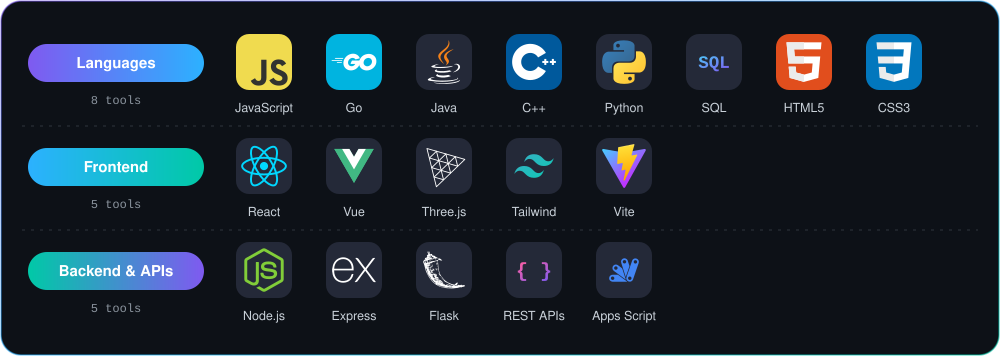
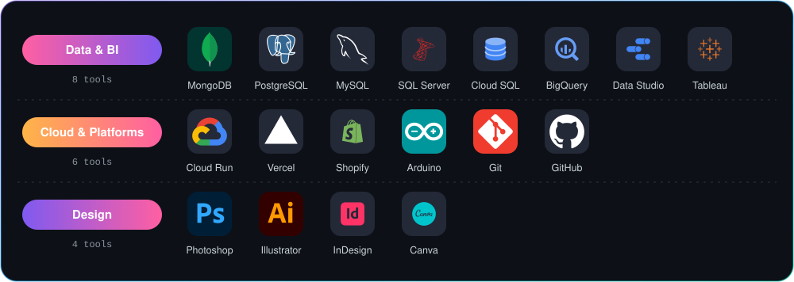
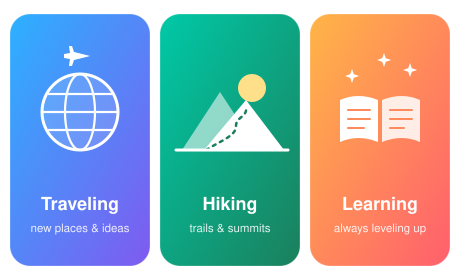

  

<h3 align="center">👋 Welcome! I design and build full-stack platforms, AI tools, and automation that move real businesses forward.</h3>

  <a href="#about"><b>About</b></a> &nbsp;•&nbsp;
  <a href="#skills"><b>Skills</b></a> &nbsp;•&nbsp;
  <a href="#projects"><b>Projects</b></a> &nbsp;•&nbsp;
  <a href="#experience"><b>Experience</b></a> &nbsp;•&nbsp;
  <a href="#contact"><b>Contact</b></a>

 

<!-- ─────────────────────────────── II. ABOUT ─────────────────────────────── -->

<table>
  <tr>
    <td width="50%" valign="top">

### Hi, I'm Brendan 👋

I'm a **Software Engineer & Architect** on Logitech's elite **IT Software Development Tiger Team**, where I lead the engineering of high-stakes software with company-wide impact.

My path has been anything but typical. I joined Logitech in **2018 on the manufacturing floor** and was promoted many times, through **analyst** and then **engineering** roles. Along the way I helped digitally transform businesses like **Ultimate Ears Pro** with heavy automation and better data, so decision makers can move faster.

- 📍 Based in **Studio City, CA**
- 🤖 **AI Champion** for the Irvine & Westlake Village offices
- 🤝 **Technical Officer & Mentor**, Google Developer Group
- 🏆 **Employee of the Year** (2023) · **4× Spotlight Award**

</td>
    <td width="50%" valign="top">
      
    </td>
  </tr>
</table>

 

<!-- ─────────────────────────── III. SKILLS & TOOLS ─────────────────────────── -->

  

  

<table>
  <tr>
    <td width="50%" valign="top">

#### 🛠️ Development Practices & Platforms

- 🏗️ **Full-stack architecture**: React/Vue front ends, Node.js & Go services, REST APIs
- 🤖 **AI engineering**: LLM model routing, AI assistants & bots, AI-powered tools
- ⚙️ **Automation**: workflow and operations automation with Apps Script & APIs
- 📊 **Data pipelines & BI**: web store → BigQuery → Data Studio / Tableau
- 👁️ **Computer vision & imaging** for QA and manufacturing
- 🔐 **Security-minded engineering**: self-healing firewalls, vendor assessment
- ☁️ **Cloud deployment** on Google Cloud Run & Vercel
- 🌱 **Version control & mentoring** with Git, GitHub and code reviews

</td>
    <td width="50%" valign="top">

#### 📜 Certifications

| Certification | Issuer |
| :-- | :-- |
| AI Proficiency | Section · ProfAI |
| Programming in JavaScript | Meta |
| Machine Learning: From Data to Decisions | MIT |
| AI & Law *(with Honors)* | Lund University |
| Ask Questions to Make Data-Driven Decisions | Google |
| Foundations: Data, Data, Everywhere | Google |

</td>
  </tr>
</table>

 

<!-- ─────────────────────────── IV. FEATURED PROJECTS ─────────────────────────── -->

  
   
  🔒 Private repository · Built for Ultimate Ears PRO

  
   
  🌐 <a href="https://github.com/hl2rs/Web-Auditor"><b>View the source on GitHub →</b></a>

  
   
  🚧 In active development · Coming soon

 

<!-- ───────────────────── V. EXPERIENCE, INTERESTS & GOALS ───────────────────── -->

### 💼 Experience

| | Role | Organization | Period |
| :-: | :-- | :-- | :-- |
|  | **Solutions Developer** IT Software Development Tiger Team: leading high-stakes software with company-wide impact | Logitech | Dec 2018 – Present |
|  | **AI Champion** Driving AI adoption for the Southern California offices | Logitech · Irvine & Westlake Village | Current |
|  | **Technical Officer & Mentor** Mentoring the next wave of developers | Google Developer Group | Apr 2026 – Present |
|  | **Manufacturing → Analyst → Engineer** Promoted repeatedly; digitally transformed UE Pro with automation & data | Logitech · Ultimate Ears Pro | Earlier roles |

<table>
  <tr>
    <td width="50%" valign="top">
      
    </td>
    <td width="50%" valign="top">

#### 🚀 Impact Highlights: *Led development of…*

**🌐 Platforms**
- Global on-demand shopping, warehouse & logistics platform for employees and 3rd parties
- Financial operations, vendor assessment, and gaming events & competitions platforms
- Internal company tools and platforms

**🤖 AI**
- CLI and AI model router
- B2C web store AI bot and standalone interfaces
- Modular, AI-powered fitment issue tool
- Automations from storage to an AI 3D modeling platform

**👁️ Vision & Imaging**
- QA computer vision models that detect defects down to the millimeter on clear surfaces
- Imaging algorithms and interfaces that enhance operations and manufacturing

**🔐 Security & Data**
- Self-healing web firewall
- Data pipelines from the web store to visualization tools

</td>
  </tr>
</table>

### 🏆 Awards & Honors

| Award | Organization | Year |
| :-- | :-- | :-- |
| 🥇 **Employee of the Year** | Logitech | 2023 |
| ✨ **Spotlight Award** | Logitech | 2022 · 2023 · 2024 · 2026 |
| 🐾 **Top Volunteer** | K9 Connection | 2023 |

<table>
  <tr>
    <td width="50%" valign="top">

#### 🎯 Goals

- 🏛️ Grow into a **software architect** designing **AI-native platforms at scale**
- 🌱 Keep **mentoring the next wave of developers** through Google Developer Groups
- ✨ Ship products that blend **great design, data, and engineering**

#### 🌄 Interests

- ✈️ **Traveling**: new places, cultures, and ideas
- 🥾 **Hiking**: trails, summits, and fresh air
- 📚 **Learning**: always leveling up, currently finishing my B.S. at ASU

</td>
    <td width="50%" valign="top">
      
    </td>
  </tr>
</table>

 

<!-- ─────────────────────────────── VI. CONTACT ─────────────────────────────── -->

<table>
  <tr>
    <td width="50%" valign="top">
      
    </td>
    <td width="50%" valign="middle">

### Let's build something together 🤝

I'm always happy to talk about **full-stack architecture**, **AI tooling**, **automation**, or **mentoring**. Reach out anytime!

  
  <!-- TODO: replace https://your-website.com with your personal website URL -->
  

  
  

</td>
  </tr>
</table>

<a href="#top">⬆ Back to top</a>

